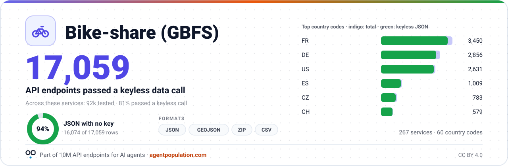
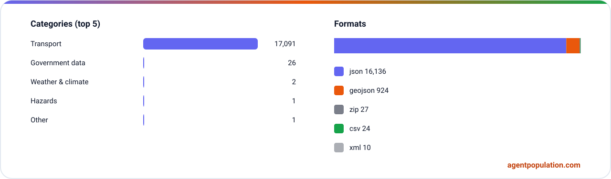

<p align="center"></p>

# 🚲 Bike-share API endpoints

**17,059 bike-share API endpoints that answered a keyless GET with a data body. For agent and app builders.**

<p align="center"><a href="#files"></a> <a href="#columns-and-tags"></a> <a href="#whats-inside"></a> <a href="#whats-inside"></a> <a href="LICENSE"></a></p>

<p align="center"><a href="#whats-in-it-for-you">What's in it</a> · <a href="#for-ai-agents">For AI agents</a> · <a href="#quick-start">Quick start</a> · <a href="#test-it-yourself">Test it yourself</a> · <a href="#files">Files</a> · <a href="#licence-and-credit">Licence</a> · <a href="#part-of-10m-api-endpoints-for-ai-agents">More packs</a></p>

This repository holds a 1,000-row sample and the services list; the full list of 17,059 endpoints is one download from the [latest release](https://github.com/agentpopulation/17k-bike-share-apis-for-agents/releases/latest).

**Endpoints for building a bike and dock availability tool.** GBFS feeds from bike, e-scooter and moped sharing systems (station status, dockless vehicles, station lists, pricing plans, vehicle types and geofencing zones), plus bike-share station layers and ridership datasets, as URLs that answered with no key on their test date. Car-sharing feeds published in GBFS are in the pack too; Known limits counts them, and they are not used as starting points.

Selection rule: rows where `tags has bike-share`, less the rows that a leave-out rule drops (each counted under Known limits).

15,832 of these 17,059 rows match the focus rule (below); the others are in the pack by the selection rule only, and Known limits says what they are.

## In plain words

**What is an API endpoint?** An API endpoint is one web address that a program can ask for data, for example the latest reading at one weather station. A single service, such as a national weather agency, can have thousands of endpoints: one per station, city or dataset. This pack counts endpoints, not separate services.

**What does "passed a data call" mean?** On the date shown in each row, AgentPopulation sent one plain request to that address, with no password or key, and got a non-empty data body back (JSON, CSV, XML or a file): not an error page and not an empty result. Some bodies describe a dataset rather than hold its values; see Known limits. It shows the address answered with data on that day. It is not a promise that it answers today, and licences and usage limits were not reviewed.

## What's in it for you

Four ways to use this pack. Each bucket gives a count, a filter you can apply to the CSV, one example that passed, and a list of recommended starting points with the rule that picked them. Buckets overlap; a row can fit more than one.

Examples, recommended lists and the preview are drawn from rows that match this pack's focus rule, so a row that the selection rule put in this pack but that is about something else is not shown as a starting point. Counts cover the whole bucket.

<details>
<summary>The focus rule</summary>

Focus rule: `title or subcategory matches /gbfs|bike|bicycle|cycle|cycling|velo|vélo|scooter|trottinette|moped|rower|bysykkel|fahrrad|vls|vaels|v'lille|dostępność|libre[- ]service|nextbike|donkey|bird|lime|dott|spin|voi|bolt|pony|beryl|zeus|veo|yego|ryde/i AND NOT title or subcategory matches /autopartage|car[- ]?shar|getaround|citiz|citédia|bildeling|\bhyre\b|stadtmobil|flinkster|teilauto|\bdeer \(|share birrer|car-ship|marguerite|auto libre-service|auto-en-velay|evie carshare|\bclem\b|clem'|mobility \(switzerland\)|edrive|conficars|\bmikar\b|leo and go/i AND NOT host ends with "getaround.com" AND NOT title matches /shared[ _]use|shared_path|share the road|docks piers|culvert/i AND NOT title matches /proposed|preliminary|closed|temporary|internal|survey|expansion|equity|demograph|nearest_public/i`

</details>

### 🤖 Agent tools: Bike, dock and scooter availability an agent can look up

**3,257** endpoints from 119 services · Wrap one station_status or vehicle_status URL as a get_bike_availability tool: pass the system and a station or a point, return bikes, e-bikes and open docks, or the nearest available vehicles, with the feed's last_updated time.

1,672 of these are `station_status` files (bikes and open docks per station or parking hub); the others list dockless vehicles (`free_bike_status` or `vehicle_status`).

Start with: `tags has agent-ready AND url matches /station_status|free_bike_status|vehicle_status/i`

Example: [GBFS station\_status: biciArteixo (Artexio, ES)](https://gbfs.nextbike.net/maps/gbfs/v2/nextbike_aa/en/station_status.json) · Nextbike · passed 2026-11-14

<details>
<summary>Recommended starting points: 8 services, picked by the stated criteria inside</summary>

**Recommended starting points.** Selected by stated criteria, not a ranking of quality: Services in this pack with the most endpoints that match this bucket and are tagged `agent-ready` (no key sent in the test call, JSON body, passed a data call). Ties go to the service with more country codes, then by name. Only services with at least one bucket row that matches the focus rule are listed, and the sample comes from those rows; the counts cover the whole bucket. The sample URL is the first row by URL sort after preferring, in this order: rows that match the bucket's sample preference when it has one, rows that return values rather than describe a dataset or a service (not ERDDAP /info/ pages, OGC GetCapabilities requests, bare OWS addresses, PxWeb tables, UN SDG series lists, Statistics Canada download pointers, WorldPop listings, GTFS validation reports, untitled rows or service root addresses), and agent-ready rows. Sample preference in this bucket: `(url matches /station_status/i AND NOT host in (mds.bird.co, gbfs.api.ridedott.com, gbfs.spin.pm, data.lime.bike, zeus.city, cluster-prod.veoride.com, api.voiapp.io, mds.bolt.eu)) OR (url matches /free_bike_status|vehicle_status/i AND host in (mds.bird.co, gbfs.api.ridedott.com, gbfs.spin.pm, data.lime.bike, zeus.city, cluster-prod.veoride.com, api.voiapp.io, mds.bolt.eu))`. Services named "ArcGIS organization" hold map layers from many owners and are added only when fewer than 5 other services match.

| Service (host) | Endpoints in bucket | In pack | Country codes in bucket | Formats in bucket | Sample URL that passed |
|---|---:|---:|---|---|---|
| Nextbike (gbfs.nextbike.net) | 591 | 2,662 | 21 codes | json | [GBFS station\_status: biciArteixo (Artex…](https://gbfs.nextbike.net/maps/gbfs/v2/nextbike_aa/en/station_status.json) (2026-11-14) |
| Donkey (stables.donkey.bike) | 363 | 1,736 | 13 codes | json | [Donkey Republic Augsburg: GBFS station\_…](https://stables.donkey.bike/api/public/gbfs/2/Augsburg/de/station_status.json) (2026-11-15) |
| api.mobidata-bw.de | 268 | 1,107 | CH, DE, LI | json | [MobiData BW sharing: GBFS station\_statu…](https://api.mobidata-bw.de/sharing/gbfs/v2/bird-chalonsenchampagne/station_status) (2026-11-15) |
| Bird (mds.bird.co) | 266 | 1,237 | 12 codes | json | [Bird Ajaccio: GBFS free\_bike\_status \[en…](https://mds.bird.co/gbfs/ajaccio/free_bike_status.json) (2026-11-15) |
| Fifteen (gbfs.partners.fifteen.eu) | 113 | 503 | DE, ES, FR | json | [GBFS station\_status: Vélo Modalis Angou…](https://gbfs.partners.fifteen.eu/gbfs/2.2/angouleme/en/station_status.json) (2026-11-14) |
| Ridedott (gbfs.api.ridedott.com) | 111 | 393 | 11 codes | json | [GBFS free\_bike\_status: Dott Aachen (Aac…](https://gbfs.api.ridedott.com/public/v2/aachen/free_bike_status.json) (2026-11-14) |
| Entur (api.entur.io) | 87 | 376 | NO | json | [Entur mobility: GBFS station\_status \[nb…](https://api.entur.io/mobility/v2/gbfs/v2/kolumbusbysykkel/station_status) (2026-11-15) |
| Ecovelo (api.gbfs.v3.0.ecovelo.mobi) | 78 | 353 | FR | json | [GBFS station\_status: 7 Vallées Vélo (Ma…](https://api.gbfs.v3.0.ecovelo.mobi/7vallees/station_status.json) (2026-11-14) |

</details>

### 📱 App features: Station maps, service areas and no-parking zones

**4,264** endpoints from 151 services · Draw a station map for one city from station_information (name, position, capacity), shade the service area from system_regions, and mark no-ride and no-parking zones from geofencing_zones.

1,182 of these are `geofencing_zones` files: GeoJSON zones where riding, parking or speed is limited.

Start with: `url matches /station_information|geofencing_zones|system_regions/i OR (subcategory matches /^ArcGIS feature layer/i AND title matches /bike ?share|bicycle share|bikeshare|brightbike/i)`

Example: [GBFS station\_information: biciArteixo (Artexio, E…](https://gbfs.nextbike.net/maps/gbfs/v2/nextbike_aa/en/station_information.json) · Nextbike · passed 2026-11-14

<details>
<summary>Recommended starting points: 8 services, picked by the stated criteria inside</summary>

**Recommended starting points.** Selected by stated criteria, not a ranking of quality: Services in this pack with the most endpoints that match this bucket and passed a data call. Ties go to the service with more country codes, then by name. Only services with at least one bucket row that matches the focus rule are listed, and the sample comes from those rows; the counts cover the whole bucket. The sample URL is the first row by URL sort after preferring, in this order: rows that match the bucket's sample preference when it has one, rows that return values rather than describe a dataset or a service (not ERDDAP /info/ pages, OGC GetCapabilities requests, bare OWS addresses, PxWeb tables, UN SDG series lists, Statistics Canada download pointers, WorldPop listings, GTFS validation reports, untitled rows or service root addresses), and agent-ready rows. Sample preference in this bucket: `url matches /station_information/i`. Services named "ArcGIS organization" hold map layers from many owners and are added only when fewer than 5 other services match.

| Service (host) | Endpoints in bucket | In pack | Country codes in bucket | Formats in bucket | Sample URL that passed |
|---|---:|---:|---|---|---|
| Nextbike (gbfs.nextbike.net) | 888 | 2,662 | 21 codes | json, geojson | [GBFS station\_information: biciArteixo (…](https://gbfs.nextbike.net/maps/gbfs/v2/nextbike_aa/en/station_information.json) (2026-11-14) |
| Donkey (stables.donkey.bike) | 421 | 1,736 | 13 codes | json | [Donkey Republic Augsburg: GBFS station\_…](https://stables.donkey.bike/api/public/gbfs/2/Augsburg/de/station_information.json) (2026-11-15) |
| Bird (mds.bird.co) | 359 | 1,237 | 12 codes | json, geojson | [GBFS station\_information: Bird Adeje (A…](https://mds.bird.co/gbfs/v2/public/adeje/station_information.json) (2026-11-14) |
| api.mobidata-bw.de | 240 | 1,107 | CH, DE, LI | json, geojson | [MobiData BW sharing: GBFS station\_infor…](https://api.mobidata-bw.de/sharing/gbfs/v2/bird-chalonsenchampagne/station_information) (2026-11-15) |
| Ecovelo (api.gbfs.v3.0.ecovelo.mobi) | 116 | 353 | FR | json, geojson | [GBFS station\_information: 7 Vallées Vél…](https://api.gbfs.v3.0.ecovelo.mobi/7vallees/station_information.json) (2026-11-14) |
| Fifteen (gbfs.partners.fifteen.eu) | 113 | 503 | DE, ES, FR | json, geojson | [GBFS station\_information: Vélo Modalis …](https://gbfs.partners.fifteen.eu/gbfs/2.2/angouleme/en/station_information.json) (2026-11-14) |
| Ridedott (gbfs.api.ridedott.com) | 112 | 393 | 11 codes | json, geojson | [GBFS station\_information: Dott Aachen (…](https://gbfs.api.ridedott.com/public/v2/aachen/station_information.json) (2026-11-14) |
| Ecovelo (api.gbfs.v2.2.ecovelo.mobi) | 108 | 431 | FR | json, geojson | [7 Vallées Vélo: GBFS station\_informatio…](https://api.gbfs.v2.2.ecovelo.mobi/7vallees/fr/station_information.json) (2026-11-15) |

</details>

### 🧠 Grounding and data pipelines: Operators, prices and vehicle types, plus ridership history

**8,386** endpoints from 160 services · Load system_information, pricing plans and vehicle types on a schedule into your own store, so an answer about what a ride costs or which e-bikes a city offers cites the operator file and its date.

1,960 of these are `system_pricing_plans` files: unlock fees and per-minute or per-kilometre prices.

Start with: `url matches /system_information|system_pricing_plans|vehicle_types|system_hours|system_calendar|system_alerts|gbfs_versions|/gbfs(\.json)?$/i OR (title matches /trip|ridership|patronage|readings 20|historical|inspection/i AND NOT title matches /shared[ _]use|shared_path|share the road|docks piers|culvert/i)`

Example: [GBFS system\_pricing\_plans: biciArteixo (Artexio, …](https://gbfs.nextbike.net/maps/gbfs/v2/nextbike_aa/en/system_pricing_plans.json) · Nextbike · passed 2026-11-14

<details>
<summary>Recommended starting points: 8 services, picked by the stated criteria inside</summary>

**Recommended starting points.** Selected by stated criteria, not a ranking of quality: Services in this pack with the most endpoints that match this bucket and passed a data call. Ties go to the service with more country codes, then by name. Only services with at least one bucket row that matches the focus rule are listed, and the sample comes from those rows; the counts cover the whole bucket. The sample URL is the first row by URL sort after preferring, in this order: rows that match the bucket's sample preference when it has one, rows that return values rather than describe a dataset or a service (not ERDDAP /info/ pages, OGC GetCapabilities requests, bare OWS addresses, PxWeb tables, UN SDG series lists, Statistics Canada download pointers, WorldPop listings, GTFS validation reports, untitled rows or service root addresses), and agent-ready rows. Sample preference in this bucket: `url matches /system_pricing_plans/i`. Services named "ArcGIS organization" hold map layers from many owners and are added only when fewer than 5 other services match.

| Service (host) | Endpoints in bucket | In pack | Country codes in bucket | Formats in bucket | Sample URL that passed |
|---|---:|---:|---|---|---|
| Nextbike (gbfs.nextbike.net) | 1,183 | 2,662 | 21 codes | json | [GBFS system\_pricing\_plans: biciArteixo …](https://gbfs.nextbike.net/maps/gbfs/v2/nextbike_aa/en/system_pricing_plans.json) (2026-11-14) |
| Donkey (stables.donkey.bike) | 952 | 1,736 | 13 codes | json | [Donkey Republic Augsburg: GBFS system\_p…](https://stables.donkey.bike/api/public/gbfs/2/Augsburg/de/system_pricing_plans.json) (2026-11-15) |
| Bird (mds.bird.co) | 612 | 1,237 | 12 codes | json | [GBFS system\_pricing\_plans: Bird Adeje (…](https://mds.bird.co/gbfs/v2/public/adeje/system_pricing_plans.json) (2026-11-14) |
| api.mobidata-bw.de | 598 | 1,107 | CH, DE, LI | json | [MobiData BW sharing: GBFS system\_pricin…](https://api.mobidata-bw.de/sharing/gbfs/v2/bird-basel/system_pricing_plans) (2026-11-15) |
| Fifteen (gbfs.partners.fifteen.eu) | 277 | 503 | DE, ES, FR | json | [GBFS system\_pricing\_plans: Vélo Modalis…](https://gbfs.partners.fifteen.eu/gbfs/2.2/angouleme/en/system_pricing_plans.json) (2026-11-14) |
| Rideyego (services.rideyego.com) | 276 | 372 | FR | json | [YEGO Bordeaux: GBFS system\_pricing\_plan…](https://services.rideyego.com/gbfs/1-1/bordeaux/en/system_pricing_plans) (2026-11-15) |
| Lyft (gbfs.lyft.com) | 273 | 447 | US | json | [Motivate LLC: GBFS system\_pricing\_plans…](https://gbfs.lyft.com/gbfs/1.1/bay/en/system_pricing_plans.json) (2026-11-15) |
| Ecovelo (api.gbfs.v2.2.ecovelo.mobi) | 251 | 431 | FR | json | [7 Vallées Vélo: GBFS system\_pricing\_pla…](https://api.gbfs.v2.2.ecovelo.mobi/7vallees/fr/system_pricing_plans.json) (2026-11-15) |

</details>

### 🧪 Evals and testing: GBFS files across versions and operators to test a feed parser

**17,059** endpoints · 267 services · 60 country codes · 5 formats · Run your GBFS parser against a fixed set of feeds from many operators and versions; check that station ids, coordinates, counts and prices parse, and keep last_tested as the baseline for your own re-tests.

Start with: the whole pack

Example: [GBFS free\_bike\_status: biciArteixo (Artexio, ES)](https://gbfs.nextbike.net/maps/gbfs/v2/nextbike_aa/en/free_bike_status.json) · Nextbike · passed 2026-11-14

<details>
<summary>Recommended starting points: 8 services, picked by the stated criteria inside</summary>

**Recommended starting points.** Selected by stated criteria, not a ranking of quality: Services in this pack that returned the most different formats, then the most endpoints that passed a data call, then by name: a mix of response shapes to test parsers and tool calls. Only services with at least one bucket row that matches the focus rule are listed, and the sample comes from those rows; the counts cover the whole bucket. The sample URL is the first row by URL sort after preferring, in this order: rows that match the bucket's sample preference when it has one, rows that return values rather than describe a dataset or a service (not ERDDAP /info/ pages, OGC GetCapabilities requests, bare OWS addresses, PxWeb tables, UN SDG series lists, Statistics Canada download pointers, WorldPop listings, GTFS validation reports, untitled rows or service root addresses), and agent-ready rows. Services named "ArcGIS organization" hold map layers from many owners and are added only when fewer than 5 other services match.

| Service (host) | Endpoints in bucket | In pack | Country codes in bucket | Formats in bucket | Sample URL that passed |
|---|---:|---:|---|---|---|
| api.mobidata-bw.de | 1,107 | 1,107 | CH, DE, LI | json, geojson, csv | [MobiData BW sharing: GBFS free\_bike\_sta…](https://api.mobidata-bw.de/sharing/gbfs/v2/bird-basel/free_bike_status) (2026-11-15) |
| Voiapp (api.voiapp.io) | 128 | 128 | BE, DE, FR | json, zip, geojson | [GBFS free\_bike\_status: VOI Antwerp (Ant…](https://api.voiapp.io/gbfs/be/7a4cb689-a2ee-409d-a5fe-49d2e8d50717/v2/free_bike_status.json) (2026-11-14) |
| Transportation (data.transportation.gov) | 32 | 32 | US | json, csv, xml | [U.S Department of Transportation: ckan\_…](https://data.transportation.gov/api/v3/views/6cfa-ipzd/query.json?accessType=DOWNLOAD) (2026-11-15) |
| data.gov.au (data.melbourne.vic.gov.au) | 7 | 7 | AU | json, csv, geojson | [Bike Share Dock Locations](https://data.melbourne.vic.gov.au/api/explore/v2.1/catalog/datasets/bike-share-dock-locations/records?limit=1) (2026-11-12) |
| ArcGIS Online: Arlington County (gisdata-arlgis.opendata.arcgis.com) | 3 | 3 | US | csv, geojson, xml | [Arlington County - GIS Portal: ckan\_res…](https://gisdata-arlgis.opendata.arcgis.com/api/download/v1/items/7da2d4682a304e0dad4c5196c277abea/csv?layers=0) (2026-11-15) |
| Nextbike (gbfs.nextbike.net) | 2,662 | 2,662 | 21 codes | json, geojson | [GBFS free\_bike\_status: biciArteixo (Art…](https://gbfs.nextbike.net/maps/gbfs/v2/nextbike_aa/en/free_bike_status.json) (2026-11-14) |
| Bird (mds.bird.co) | 1,237 | 1,237 | 12 codes | json, geojson | [Bird Ajaccio: GBFS free\_bike\_status \[en…](https://mds.bird.co/gbfs/ajaccio/free_bike_status.json) (2026-11-15) |
| Fifteen (gbfs.partners.fifteen.eu) | 503 | 503 | DE, ES, FR | json, geojson | [GBFS free\_bike\_status: Vélo Modalis Ang…](https://gbfs.partners.fifteen.eu/gbfs/2.2/angouleme/en/free_bike_status.json) (2026-11-14) |

</details>

The same lists are in [recommended.json](recommended.json), ready for an agent to load.

## Questions an agent can answer with this pack

- How many bikes and open docks does a BIKETOWN station in Portland report? Try [GBFS station\_status: BIKETOWN (Portland, OR)](https://gbfs.lyft.com/gbfs/2.3/pdx/en/station_status.json) (Lyft, passed 2026-11-14).
- Which Bird e-scooters are available to ride in a given city, and where are they? Try [GBFS free\_bike\_status: Bird Adeje (Adeje)](https://mds.bird.co/gbfs/v2/public/adeje/free_bike_status.json) (Bird, passed 2026-11-14).
- What does a Donkey Republic bike cost to unlock and ride in a given city? Try [GBFS system\_pricing\_plans: Donkey Republic Augsbu…](https://stables.donkey.bike/api/public/gbfs/3.0/Augsburg/system_pricing_plans.json) (Donkey, passed 2026-11-14).
- Where may Dott scooters not be ridden or parked in a given city? Try [GBFS geofencing\_zones: Dott Berlin (Berlin)](https://gbfs.api.ridedott.com/public/v2/berlin/geofencing_zones.json) (Ridedott, passed 2026-11-14).

## What "passed a data call" means

> [!NOTE]
> On the date in `last_tested` (IST), one GET to the URL, sent with no key, returned HTTP 2xx and a non-empty data body. HTML pages and empty results did not pass. The `format` column records what came back. This is a test result for that date, not a promise that the URL answers today. Licences, terms, rate limits, accuracy and freshness were not reviewed. Endpoints are URLs, not separate APIs; many share one service. This pack was tested 11–15 Nov 2026; snapshot 15 Nov 2026.

## For AI agents

Start from keyless JSON endpoints (`agent-ready`). The code below loads `recommended.json` and calls the first recommended service in the Agent tools bucket, with a timeout (`node examples/agent-start.mjs --recommended`). With no argument, `node examples/agent-start.mjs` calls the most recently tested agent-ready row of the sample; pass a `.csv` or `.csv.gz` path to use that file instead. See [examples/agent-start.mjs](examples/agent-start.mjs).

```js
// Node 18+. Loads recommended.json (the local copy, or the raw file on GitHub) and calls one keyless JSON endpoint.
import fs from 'node:fs';

const RAW = 'https://raw.githubusercontent.com/agentpopulation/17k-bike-share-apis-for-agents/main/recommended.json';
const rec = fs.existsSync('recommended.json')
  ? JSON.parse(fs.readFileSync('recommended.json', 'utf8'))
  : await (await fetch(RAW)).json();

const pick = rec.buckets.find((b) => b.id === 'agent').services[0];
try {
  const res = await fetch(pick.sample_url, {
    headers: { 'User-Agent': 'agent-example/1.0' },
    signal: AbortSignal.timeout(15000),
  });
  console.log(pick.service, res.status, res.headers.get('content-type'));
  console.log((await res.text()).slice(0, 300));
} catch (err) {
  console.log(`did not answer now; last passed ${pick.sample_last_tested} (${err.message})`);
}
```

How an agent picks an endpoint:

1. Filter to `agent-ready` and your country or topic.
2. Prefer the newest `last_tested` and the larger services.
3. Call with a timeout and check the body before you use it.

## Quick start

The examples run against the sample in `data/` out of the box (1,000 rows). Each takes an optional path to a `.csv` or `.csv.gz` file instead.

```bash
git clone https://github.com/agentpopulation/17k-bike-share-apis-for-agents.git
cd 17k-bike-share-apis-for-agents
python examples/quickstart.py
node examples/quickstart.mjs
node examples/agent-start.mjs
```

Full list: download `Bike_Share_API_Endpoints_AgentPopulation_Snapshot_2026-11-15.csv.gz` (17,059 rows, 444.1 kB) from [releases/latest](https://github.com/agentpopulation/17k-bike-share-apis-for-agents/releases/latest), then gunzip it and pass its path. The scripts also read the `.csv.gz` as it is.

```bash
gunzip Bike_Share_API_Endpoints_AgentPopulation_Snapshot_2026-11-15.csv.gz
python examples/quickstart.py Bike_Share_API_Endpoints_AgentPopulation_Snapshot_2026-11-15.csv
node examples/quickstart.mjs Bike_Share_API_Endpoints_AgentPopulation_Snapshot_2026-11-15.csv
```

### curl

Quote the URL: some contain commas.

```bash
curl -sL "https://raw.githubusercontent.com/agentpopulation/17k-bike-share-apis-for-agents/main/data/Bike_Share_API_Endpoints_AgentPopulation_Sample.csv" | head -n 4
curl -s --max-time 15 "https://gbfs.nextbike.net/maps/gbfs/v2/nextbike_aa/en/station_status.json" | head -c 600
```

### Python

Standard library only: [examples/quickstart.py](examples/quickstart.py) reads the sample, or the path you pass, keeps agent-ready rows and calls the most recently tested one.

<details>
<summary>The code</summary>

```python
# Python 3, standard library only. Run from a clone of this repository:
#   python examples/quickstart.py [path]
# With no path it reads the sample in data/. Pass the full list from the latest release (.csv or .csv.gz) instead.
# Keeps agent-ready rows and calls the most recently tested one.
import csv
import gzip
import os
import re
import sys
import urllib.request

HERE = os.path.dirname(os.path.abspath(__file__))
path = sys.argv[1] if len(sys.argv) > 1 else os.path.join(HERE, "..", "data", "Bike_Share_API_Endpoints_AgentPopulation_Sample.csv")
opener = gzip.open if path.endswith(".gz") else open
with opener(path, "rt", newline="", encoding="utf-8") as f:
    rows = list(csv.DictReader(f))

agent = [r for r in rows if "agent-ready" in r["tags"].split("|")]
# Newest test date first; URLs that describe a dataset or a service rather than return values go last.
DESCRIBES = re.compile(r"/erddap/info/|action-report\.json$|[?&]request=getcapabilities|/GeoArea/[^/?]+/List|getFullTableDownloadCSV|hub\.worldpop\.org", re.I)
agent.sort(key=lambda r: r["last_tested"], reverse=True)
agent.sort(key=lambda r: 1 if DESCRIBES.search(r["url"]) else 0)
print(len(rows), "rows,", len(agent), "agent-ready")
if not agent:
    sys.exit(0)

row = agent[0]
req = urllib.request.Request(row["url"], headers={"User-Agent": "agent-example/1.0"})
try:
    with urllib.request.urlopen(req, timeout=15) as res:
        body = res.read(1_000_000).decode("utf-8", "replace")
        print(res.status, res.headers.get("Content-Type"))
        print(body[:300])
except Exception as err:
    print(f"did not answer now; last passed {row['last_tested']} ({err})")
```

</details>

### JavaScript

Reads the sample as JSON because the CSV has quoted commas.

<details>
<summary>The code</summary>

```js
// Node 18+. Reads the sample as JSON (the CSV has quoted commas), local file first.
import fs from 'node:fs';

const FILE = 'data/Bike_Share_API_Endpoints_AgentPopulation_Sample.json';
const rows = fs.existsSync(FILE)
  ? JSON.parse(fs.readFileSync(FILE, 'utf8'))
  : await (await fetch('https://raw.githubusercontent.com/agentpopulation/17k-bike-share-apis-for-agents/main/data/Bike_Share_API_Endpoints_AgentPopulation_Sample.json')).json();

const row = rows.find((r) => r.tags.includes('agent-ready'));
const res = await fetch(row.url, { headers: { 'User-Agent': 'agent-example/1.0' }, signal: AbortSignal.timeout(15000) });
console.log(res.status, (await res.text()).slice(0, 300));
```

</details>

### Agent tools

[examples/agent-tools.json](examples/agent-tools.json) holds two tool definitions in the shape most tool-calling APIs accept (name, description, JSON Schema); rename `parameters` if yours uses another key. [examples/quickstart.mjs](examples/quickstart.mjs) implements them:

- `find_endpoints` searches the agent-ready rows of the list by words, country code (their format is json). When you load the tools of more than one pack, prefix the names (for example `bike_share_find_endpoints`) so they do not clash.
- `fetch_endpoint` calls one URL, **refuses any URL that is not in the list** and does not follow redirects. The allowlist is built from the CSV, so a URL injected into a prompt is refused.

The same two tools can sit behind an MCP server.

## Test it yourself

Re-test endpoints from the sample with the same rule: HTTP 2xx and a non-empty body that is not an HTML page. Node 18+, no packages.

```bash
node tools/test-endpoints.mjs
```

It tests the first 50 URLs and prints one line: tested, passed, did not pass. Options: a `.csv` or `.csv.gz` path (the full list from the release), `--limit 50`, `--timeout-ms 10000`, `--out results.csv`. The results file holds `url`, `status`, `passed`, `content_type`, `ms` and `checked_at`; a status of `timeout` or `error:<code>` means no HTTP answer came back. It is polite: GET only, no key sent, at most 4 requests in flight, one at a time per listed host, at least 1 second between requests to one listed host, and reading stops once 256 kB of a body is kept. Redirects are followed and may lead to another host. `results.csv` is in `.gitignore`.

## Preview

One row from each of the five largest services among rows that match the focus rule, services with rows that return values first.

| Title | Service | Country | Format | Tested | Link |
|---|---|---|---|---|---|
| GBFS free\_bike\_status: biciArteixo (Artexio, ES) | Nextbike | ES | json | 2026-11-14 | [gbfs.nextbike.net](https://gbfs.nextbike.net/maps/gbfs/v2/nextbike_aa/en/free_bike_status.json) |
| Donkey Republic Augsburg: GBFS free\_bike\_status \[de\]: Donke… | Donkey | DE | json | 2026-11-15 | [stables.donkey.bike](https://stables.donkey.bike/api/public/gbfs/2/Augsburg/de/free_bike_status.json) |
| Bird Ajaccio: GBFS free\_bike\_status \[en\]: Bird Ajaccio (Aja… | Bird | FR | json | 2026-11-15 | [mds.bird.co](https://mds.bird.co/gbfs/ajaccio/free_bike_status.json) |
| MobiData BW sharing: GBFS free\_bike\_status: bird-basel | api.mobidata-bw.de | DE | json | 2026-11-15 | [api.mobidata-bw.de](https://api.mobidata-bw.de/sharing/gbfs/v2/bird-basel/free_bike_status) |
| CityBikes: All bike-share networks | Citybik | ES | json | 2026-11-15 | [api.citybik.es](https://api.citybik.es/v2/networks) |

Browse the 1,000-row sample: [Sample CSV](data/Bike_Share_API_Endpoints_AgentPopulation_Sample.csv) · [Sample JSON](data/Bike_Share_API_Endpoints_AgentPopulation_Sample.json).

## What's inside

<p align="center"></p>

<details>
<summary>Country codes: 60</summary>

| Code | Country | Endpoints | |
|---|---|---:|---|
| FR | France | 3,450 | `████████████████████` |
| DE | Germany | 2,856 | `████████████████▌` |
| US | United States | 2,631 | `███████████████▎` |
| ES | Spain | 1,009 | `█████▉` |
| CZ | Czechia | 783 | `████▌` |
| CH | Switzerland | 579 | `███▍` |
| NO | Norway | 554 | `███▎` |
| GB | United Kingdom | 491 | `██▉` |
| RO | Romania | 419 | `██▍` |
| CA | Canada | 403 | `██▍` |
| | other 50 codes | 3,880 | |
| | global or unknown | 4 | `▏` |

</details>

<details>
<summary>Categories: top 5</summary>

| Category | Endpoints | |
|---|---:|---|
| Transport & Mobility | 17,029 | `████████████████████` |
| Government & Open Data | 26 | `▏` |
| Weather & Climate | 2 | `▏` |
| Hazards | 1 | `▏` |
| Other | 1 | `▏` |

</details>

Formats: json 16,074 · geojson 924 · zip 27 · csv 24 · xml 10

<details>
<summary>Largest services: top 25 of 267</summary>

| Service | Host | Endpoints | Keyless JSON | |
|---|---|---:|---:|---|
| Nextbike | gbfs.nextbike.net | 2,662 | 2,376 | `████████████████████` |
| Donkey | stables.donkey.bike | 1,736 | 1,736 | `█████████████` |
| Bird | mds.bird.co | 1,237 | 1,224 | `█████████▎` |
| api.mobidata-bw.de | api.mobidata-bw.de | 1,107 | 1,049 | `████████▍` |
| Citybik | api.citybik.es | 813 | 813 | `██████▏` |
| Getaround † | getaround.com | 718 | 718 | `█████▍` |
| Fifteen | gbfs.partners.fifteen.eu | 503 | 458 | `███▊` |
| Lyft | gbfs.lyft.com | 447 | 447 | `███▍` |
| Ecovelo | api.gbfs.v2.2.ecovelo.mobi | 431 | 397 | `███▎` |
| Ridedott | gbfs.api.ridedott.com | 393 | 353 | `███` |
| Entur | api.entur.io | 376 | 342 | `██▉` |
| Bcycle | gbfs.bcycle.com | 374 | 374 | `██▊` |
| Rideyego | services.rideyego.com | 372 | 336 | `██▊` |
| Ecovelo | api.gbfs.v3.0.ecovelo.mobi | 353 | 317 | `██▋` |
| Spin | gbfs.spin.pm | 315 | 312 | `██▍` |
| Zeus | zeus.city | 270 | 225 | `██` |
| beryl-gbfs-production.web.app | beryl-gbfs-production.web.app | 242 | 218 | `█▉` |
| Cyclocity | api.cyclocity.fr | 226 | 226 | `█▊` |
| Citiz † | backend.citiz.fr | 144 | 127 | `█▏` |
| Rideflamingo | data.rideflamingo.com | 144 | 128 | `█▏` |
| Veoride | cluster-prod.veoride.com | 144 | 144 | `█▏` |
| Voiapp | api.voiapp.io | 128 | 100 | `█` |
| proxy.transport.data.gouv.fr | proxy.transport.data.gouv.fr | 91 | 91 | `▋` |
| Publicbikesystem | sibiu.publicbikesystem.net | 85 | 85 | `▋` |
| Cooltra | maas.zeus.cooltra.com | 75 | 60 | `▋` |

† No row of these services matches the focus rule: the selection rule put them in this pack, so they are not used as a starting point.

</details>

<details>
<summary>Rows per test date: 11–15 Nov 2026</summary>

| Date (IST) | Endpoints | |
|---|---:|---|
| 2026-11-15 | 8,960 | `████████████████████` |
| 2026-11-14 | 7,937 | `█████████████████▊` |
| 2026-11-13 | 2 | `▏` |
| 2026-11-12 | 133 | `▎` |
| 2026-11-11 | 27 | `▏` |

</details>

## Files

| File | Rows | Size | Use |
|---|---:|---:|---|
| [data/Bike_Share_API_Services_AgentPopulation.csv](data/Bike_Share_API_Services_AgentPopulation.csv) | 267 | 13.6 kB | One row per service with its endpoint count in this pack |
| [data/Bike_Share_API_Endpoints_AgentPopulation_Sample.csv](data/Bike_Share_API_Endpoints_AgentPopulation_Sample.csv) | 1,000 | 266.5 kB | The sample: focus-rule rows first, each service in proportion to its share; ArcGIS Online layers count as one service |
| [data/Bike_Share_API_Endpoints_AgentPopulation_Sample.json](data/Bike_Share_API_Endpoints_AgentPopulation_Sample.json) | 1,000 | 467.8 kB | The same rows as JSON, tags as an array |
| [Bike_Share_API_Endpoints_AgentPopulation_Snapshot_2026-11-15.csv.gz](https://github.com/agentpopulation/17k-bike-share-apis-for-agents/releases/latest) | 17,059 | 444.1 kB | The full list, gzipped CSV: a download from the latest release, checked by `SHA256SUMS.txt` |
| [tools/test-endpoints.mjs](tools/test-endpoints.mjs) | | | Re-tests endpoints from the sample or the full list |

Sample size: 1,000 rows, which is 1,000 or one third of the pack rounded down, whichever is smaller. Rows that match the focus rule come first. Each service gets rows in proportion to its share of those rows, at least one for the largest services and at most 50% of the sample while other services have rows; ArcGIS Online layers count as one service, whatever their organisation. Within a service, agent-ready rows, rows that return values and the newest test dates come first, and rows are written in turn across services. Service root addresses are placed at the end of the sample.

Full list: download `Bike_Share_API_Endpoints_AgentPopulation_Snapshot_2026-11-15.csv.gz` (17,059 rows, 444.1 kB) from [releases/latest](https://github.com/agentpopulation/17k-bike-share-apis-for-agents/releases/latest), then gunzip it and pass its path. The scripts also read the `.csv.gz` as it is.

Excel users: Data > From Text/CSV, UTF-8. Files are UTF-8 without a byte-order mark and comma-separated.

## Columns and tags

<details>
<summary>Columns, types and tags</summary>

| Column | Type | Example | Meaning |
|---|---|---|---|
| url | string | [https://gbfs.nextbike.net/maps/gbfs/v2/…](https://gbfs.nextbike.net/maps/gbfs/v2/nextbike_aa/en/free_bike_status.json) | The address that was tested |
| title | string | GBFS free\_bike\_status: biciArteixo (Art… | Station, dataset or feed name |
| service | string | Nextbike | The service the endpoint belongs to; joins to the services file together with host |
| host | string | gbfs.nextbike.net | Host name of the address |
| country | string | ES | ISO 3166-1 alpha-2 code, or EU; empty when global or unknown |
| category | string | Transport & Mobility | Category of the endpoint |
| subcategory | string |  | Left empty from the 15 Nov 2026 snapshot; kept so the columns stay the same |
| format | string | json | What the test call returned: json, csv, geojson, xml, gtfs, zip, txt and so on |
| tags | string | `transit\|bike-share\|gbfs\|maps\|no-key\|jso…` | Tags separated by \| |
| last_tested | date | 2026-11-14 | Date of the test call, YYYY-MM-DD (IST) |

| Tag | Rows | Meaning |
|---|---:|---|
| bike-share | 17,059 | Topic tag |
| no-key | 17,059 | No key was sent in the test call |
| transit | 17,032 | Topic tag |
| agent-ready | 16,074 | No key sent, JSON body, passed a data call on last_tested |
| json | 16,074 | Format of the body |
| gbfs | 16,051 | GBFS feed |
| maps | 2,790 | Topic tag |
| geojson | 924 | Format of the body |
| open-data | 266 | Topic tag |
| government | 32 | Topic tag |
| csv | 24 | Format of the body |
| traffic | 13 | Topic tag |
| maritime | 11 | Topic tag |
| xml | 10 | Format of the body |
| health | 2 | Topic tag |
| parking | 2 | Topic tag |
| weather | 2 | Topic tag |
| climate | 1 | Topic tag |
| hazards | 1 | Topic tag |
| science | 1 | Topic tag |

A machine-readable copy of this dictionary is in [datapackage.json](datapackage.json).

</details>

## Known limits

- 20.2% of rows carry country code FR; 4 rows have no code (global or unknown).
- 123 rows are map-layer queries with resultRecordCount set: the tested call asked for a few records; change the query to get the full layer.
- 15 rows carry limit=1: the tested call asked for one record; raise the limit or page through.
- 161 rows are open-data portal dataset records, which may return a dataset record with links rather than the table itself.
- 27 rows are files (zip 27) rather than bodies an agent reads directly.
- 78 rows are layers on ArcGIS Online, where anyone can publish: some are class projects, tests or copies. Check the owner and the fields before you rely on one.
- 1,201 rows are car-sharing feeds published in GBFS (Getaround, Citiz, autopartage and carsharing services), not bikes or scooters; they are not used as starting points.
- 13 rows are map layers of shared-use paths, shared roads or piers that hold no bike-share data.
- 10 rows are planning or status layers (proposed, preliminary, closed, temporary, internal, survey or demand-study stations) that may not show stations in service; they are not used as starting points.
- 30 rows are past trips, ridership counts, inspections or station readings: history, not current availability.
- 3,257 rows are availability files whose values can change from minute to minute; the body on the test date is a past state, so fetch the URL again for current counts.
- GBFS feeds in this pack use more than one version of the specification (2.x and 3.0 paths both appear); version 3.0 renames free_bike_status to vehicle_status and changes some fields, so read the version from gbfs.json or gbfs_versions before you parse.
- Stations and feeds can go quiet after their test date; re-test a URL before you rely on it.
- Not in this pack: endpoints that need a key or a POST, and URLs that did not pass.
- Left out: 2 ArcGIS Survey123 layers (they can hold people's form answers).
- Left out: 1 ArcGIS layer that keeps a form's default service name (it can hold people's form answers).
- Left out: 2 ArcGIS class or coursework layers (lab, assignment, exam, quiz, lesson, exercise, tutorial and final-project layers, copies of class layers, layers named for a person or a person's home, and layers whose name ends in a person's name or holds a student number).
- Left out: 12 rows of ArcGIS Online organisations that are class accounts (3 class sets or more in at least 20% of their rows, 10 class sets or more with no organisation name, or layers signed by students read by hand): their other layers are students' work too.
- Left out: 49 rows of the ArcGIS Online organisations of universities, colleges and schools (many of their layers are students' work).

## Licence and credit

> [!IMPORTANT]
> This list (URLs, titles, tags and test results) is © 2026 AgentPopulation, released under [CC BY 4.0](https://creativecommons.org/licenses/by/4.0/). Credit AgentPopulation and link agentpopulation.com. The data each endpoint returns belongs to its provider and stays under that provider's terms; this licence does not cover it.

Copy-ready credit:

`Bike-share API endpoints by AgentPopulation (https://agentpopulation.com), CC BY 4.0, snapshot 15 Nov 2026.`

GitHub's "Cite this repository" button reads [CITATION.cff](CITATION.cff).

<!-- agentpopulation:start -->
## Part of 10M API endpoints for AI agents

This pack is one of the 50 topic packs of [10m-open-apis-for-ai-agents](https://github.com/agentpopulation/10m-open-apis-for-ai-agents), the open collection by [AgentPopulation](https://agentpopulation.com). Target: 10 million+ open API endpoints that pass a keyless API call.

AgentPopulation has tested over 5 million API endpoints: 5,129,834 tested, 3,726,509 passed a data call (snapshot 15 Nov 2026). This is the bike-share pack: 17,059 endpoints from 267 services. Packs overlap, so an endpoint can appear in more than one.

For the latest tested endpoints, search [agentpopulation.com/apis](https://agentpopulation.com/apis). This pack is a snapshot from 15 Nov 2026.

Sibling packs that share the most URLs with this one: [240k-transit-apis-for-agents](https://github.com/agentpopulation/240k-transit-apis-for-agents) (17,059 shared) · [2.2m-agent-ready-apis](https://github.com/agentpopulation/2.2m-agent-ready-apis) (16,074 shared) · [1.2m-government-open-data-apis](https://github.com/agentpopulation/1.2m-government-open-data-apis) (26 shared) · [22k-traffic-apis-for-agents](https://github.com/agentpopulation/22k-traffic-apis-for-agents) (13 shared) · [130k-india-apis-for-agents](https://github.com/agentpopulation/130k-india-apis-for-agents) (8 shared) · [10k-parking-apis-for-agents](https://github.com/agentpopulation/10k-parking-apis-for-agents) (2 shared). The rest are listed in [10m-open-apis-for-ai-agents](https://github.com/agentpopulation/10m-open-apis-for-ai-agents).

Questions, pack requests, reports of endpoints that stopped answering and requests to remove a row go to [Discussions](https://github.com/agentpopulation/10m-open-apis-for-ai-agents/discussions), or to [@agentpopulation](https://x.com/agentpopulation) on X. The packs are a work in progress and corrections are welcome.

Spotted a wrong row or a dead URL? Tell us on X: [@agentpopulation](https://x.com/agentpopulation).

If this pack saved you time, a star helps others find it.

---

Compiled by [AgentPopulation](https://agentpopulation.com) with [AP Desk](https://github.com/agentpopulation/apdesk) · [10m-open-apis-for-ai-agents](https://github.com/agentpopulation/10m-open-apis-for-ai-agents)

<!-- agentpopulation:end -->
